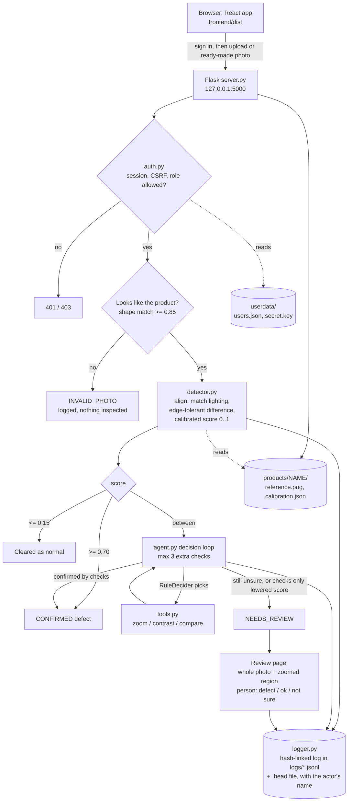

# Architecture

Everything below exists, runs on one computer, and was tested. No cloud service is used.

## Parts

| File | Job |
|---|---|
| `detector.py` | Alignment, lighting match, edge-tolerant difference, calibration, scoring, wrong-photo checks |
| `tools.py` | Zoom, contrast (CLAHE), re-compare with small shift search |
| `agent.py` | Decision loop, safety rule (checks cannot dismiss a defect), escalation |
| `logger.py` | Hash-linked audit log and `verify()` |
| `auth.py` | Accounts, sessions, CSRF, roles, lockout, settings |
| `server.py` | JSON API, serves the built app, security headers |
| `labs.py` | The three labs: stress test (paint a defect), challenge (you against the agent), tolerance lab (replay the real photos at any decision lines) |
| `manage_users.py` | Command-line account help (list, create, reset, role) |
| `build_product.py` | Builds a product's reference, calibration and sample photos |
| `eval_mvtec.py`, `eval_agent.py`, `smoke_test.py` | Evaluation and end-to-end tests (136 checks) |
| `frontend/` | The React app (source in `src/`, built output in `dist/`) |

## Interface
A React single-page app (React Router). The front page is public; everything under `/app` needs a signed-in account. Pages are loaded on demand. "Live" data on the dashboard, review queue and activity feed comes from polling the API every few seconds, not from push messages.

- `src/pages/landing`: front page (scanner animation, in-page demo with recorded scores, walkthrough, results, FAQ)
- `src/pages/auth`: sign in, sign up, forgot password (explains the local reset)
- `src/pages/app`: Dashboard, Inspect, Inspections, Inspection detail, Review, Audit log, Insights, Stress test, Challenge, Tolerance lab, Products, Team, Settings, Help
- `src/components`: viewer (zoom, pan, blend, split), painter (paintable photo), score track, steps, charts, hotspot map, camera capture, command palette, notifications, canvas scanner
- All text is rendered by React, which escapes it. The server sends a strict Content-Security-Policy and other security headers.

## Roles
| Role | Can |
|---|---|
| administrator | Everything: people, products, settings, exports |
| reviewer | Inspect photos, decide unsure cases, comment |
| viewer | Look at results, history and the audit log |

## API (all `/api` routes need a session except health and the sign-in routes; changes need the CSRF header)

| Endpoint | Purpose |
|---|---|
| `GET /api/auth/me`, `POST /api/auth/signin`, `POST /api/auth/signup`, `POST /api/auth/signout` | Session |
| `POST /api/auth/password`, `PATCH /api/auth/profile` | Own account |
| `GET/POST /api/users`, `PATCH /api/users/<id>`, `POST /api/users/<id>/reset-password`, `GET/PATCH /api/settings` | People and sign-up settings (administrator) |
| `POST /api/inspect`, `POST /api/inspect-sample/<product>/<name>` | Run an inspection |
| `GET /api/result/<id>`, `GET /api/inspections`, `GET /api/stats`, `GET /api/config`, `GET /api/activity` | Results, history, numbers, thresholds, recent events |
| `GET /api/view/<id>/test\|reference\|diff`, `GET /api/image/<id>?size=` | Photo, lined-up reference, difference heat map (same size, so boxes line up), thumbnails |
| `GET /api/review-queue`, `POST /api/review/<id>` | Cases waiting for a person; save a decision once |
| `GET/POST /api/inspections/<id>/comments` | Comments on an inspection |
| `GET /api/log/<id>`, `GET /api/audit/events`, `GET /api/audit/verify` | Audit log, all events, whole-record integrity check |
| `GET /api/export` | One zip of results, logs and comments (photos with `?photos=1`); administrator only. The Inspections page also builds a CSV in the browser from the list. |
| `GET/POST /api/products`, `GET /api/product-image/<product>/...` | Products, reference and ready-made photos |
| `POST /api/stress/try`, `POST /api/stress/sweep` | Inspect a painted photo, or the same mark at eight strengths. Nothing is saved |
| `POST /api/challenge/start`, `GET .../<token>/<n>/photo`, `POST .../<token>/<n>/answer`, `POST .../<token>/finish`, `GET /api/challenge/leaderboard`, `GET /api/challenge/status` | The game. The truth is only returned after an answer |
| `GET /api/lab/data`, `GET /api/lab/photo/<product>/<n>` | Every real test photo's scores for the replay (computed once, cached in `userdata/`) and thumbnails |
| `GET /api/health` | Public status check |

## Design choices
- **Calibration instead of fixed thresholds:** "normal" is learned from good photos of each product.
- **Safety rule:** a missed defect is worse than a false alarm, so extra checks can only confirm.
- **Swappable decider:** the agent asks a decider which check to try next. Only simple rules are used here; another decider with the same `choose()` method can be plugged in.
- **Who did it:** every decision and comment in the audit log carries the signed-in person's name.
- **Sign-out everywhere:** changing a role, disabling an account, or resetting a password invalidates that person's sessions at once.
- **The labs run the real agent:** the stress test and the challenge call `agent.inspect()` itself (logs go to a temporary folder that is emptied after each call). The tolerance lab stores each defect's first score and what every extra check would say (they do not depend on the decision lines), then replays the agent's own rule for any pair of lines. `smoke_test.py` checks that replay against the real agent at three different pairs of lines.
- **The challenge hides the answer:** photos are served by round number with no file name and no caching, and the truth, the real defect outline and the agent's answer are only returned after the person has answered.
- **Not built:** cloud hosting, email, two-step sign-in, push updates, changing the live decision lines from the app.
